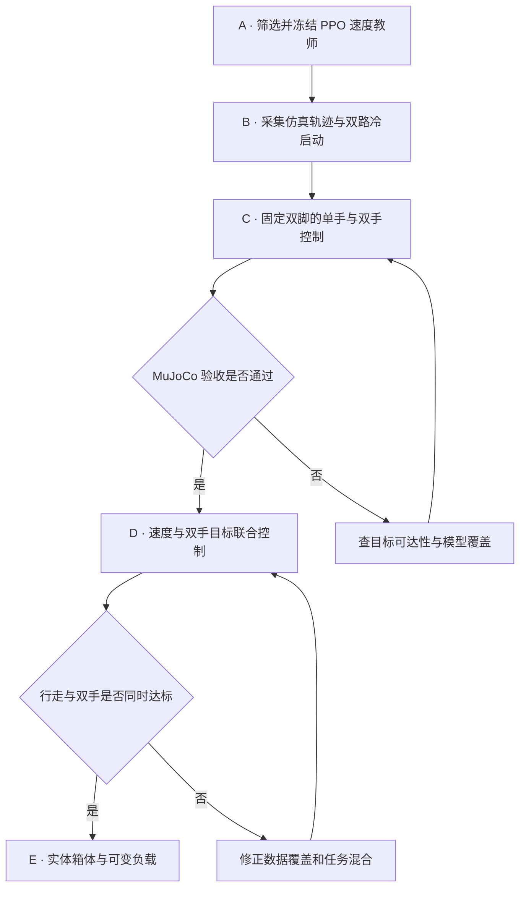
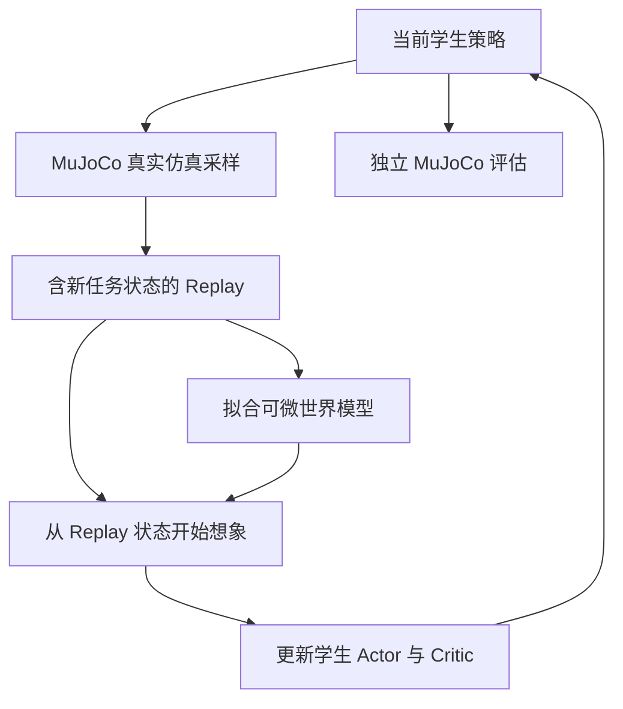

# Unitree G1 29-DOF · PPO 教师 + SuperMimic WBC 训练实施方案

> **当前进度**　原生 mjlab 速度 PPO 已训练完成，`model_9999.pt` 已完成定性回放，用户反馈整体效果良好。下一步进入 **B1 教师采集短测**。不用先导出 ONNX、做 Sim2Sim 或部署真机。  
> **阅读方式**　在 VS Code 打开本文件，按 `Ctrl+Shift+V` 预览（macOS 为 `⌘⇧V`）。新版 VS Code 的 Markdown 预览支持下文的 Mermaid。若旧版只显示代码块，可升级 VS Code 或启用支持 Mermaid 的 Markdown 预览扩展。所有阶段的表格和文字不依赖图表渲染。  
> **文档性质**　这是基于当前讨论整理的开发与验收方案。标为「建议起点」的数值不是已有实验结果。

## 1. 项目目标和范围

目标是在 G1 29-DOF 上训练**一个闭环全身策略**。纯速度指令下，它能站立、前后走、侧移和转向。手部目标开启时，它能协调手臂、腰和腿跟踪单手或双手位姿，并支持两类不同任务。

| 任务 | 机体命令 | 手部命令 | 足部要求 |
| --- | --- | --- | --- |
| 纯速度 | `vx, vy, wz` 可变 | 两只手均关闭 | 允许行走与保护性补步 |
| 固定双脚操作 | 速度指令固定为零 | 单手或双手 6D 位姿 | 在正常可达目标下足部位置和朝向保持稳定，腰腿可屈伸 |
| 移动中操作 | `vx, vy, wz` 可变 | 单手或双手 6D 位姿 | 允许迈步，速度与手部跟踪在同一段时间里成立 |
| 实体箱搬运 | 先低速，之后再扩展 | 由箱体搬运目标生成双手目标 | 后续阶段，需加入真实接触和负载动力学 |

**已确认的约束**

- 不使用外部人体参考动作数据集，不要求从人体动作逐帧跟踪。教师和学生在 MuJoCo 中生成的状态转移仍然是训练数据。
- 教师只提供纯速度控制示范。手部任务开启后，不用教师全身动作监督拉回它原来的步态和手臂姿态。
- 教师零速站立和抗推测试允许保护性补步。它与学生的固定双脚操作不是同一个验收任务。
- 第一版不提供力或力矩**指令**。仿真中仍可读取接触、施加推扰、记录扰动，也可用这些信息训练或评估。
- 最终验收在 **MuJoCo 中闭环执行**。世界模型预测和想象奖励都是训练与诊断信号，不是通过依据。
- 目标训练资源是**单卡 RTX 4090 24 GB**。PPO 教师已在该工作流跑通。WBC 世界模型和学生的训练规模、速度与效果仍需实测，不能用教师显存或原论文 H100 结果推算。

## 2. 整体流程



D 和 E 只在前一阶段通过验收后进入。**B 阶段可以直接使用训练时的 mjlab 环境。** Sim2Sim 是将来接入独立部署程序后的验证，不是数据采集的前置条件。教师可以一直以原始 `.pt` 形式服务于训练。

### 2.1 继承原版什么，本项目增加什么

| 项目 | SuperMimic 原有思路 | 本项目的实现 |
| --- | --- | --- |
| 世界模型 | 拟合仿真中的状态转移，在短的想象展开里提供可微动力学 | 保留。先以速度教师数据冷启动，然后加入学生真实仿真转移 |
| 策略目标 | 论文主体是参考动作跟踪，另展示了速度目标接口 | 第一版直接优化速度与手部位姿目标，不依赖参考动作目标 |
| 学生初始化 | 原版随训练流程学习控制能力 | 加一条 PPO 教师行为克隆路径，先让学生独立走起来 |
| 策略结构 | 目标编码器与共享全身解码器 | 第一版可用**一个条件编码器 + 一个共享解码器**。模式与掩码是条件，不是另开多个独立控制器 |
| 代码和入口 | 官方提供 `SuperMimic-GenCoord-G1` 与 `SuperMimic-MaxCoord-G1` 等跟踪入口 | 新增速度与双手目标任务、采集和冷启动入口。不能把原任务接口或速度 slot 当成现成的无参考联合训练 |

**实现顺序**　先核对官方世界模型的状态、动作和终止接口，优先打通一个状态表示。可先以 `GenCoord` 作为实现候选，状态转换和可微 FK 验证通过后再扩大规模。本项目不要求同时维护两种世界模型。

## 3. 学生的命令、状态和输出契约

建议从 B 阶段开始固定 Actor 的输入形状，后续切换任务时只改变命令和掩码值。以下是**建议接口**，不是教师原有输入结构。

| 字段 | 初版语义 | 约定 |
| --- | --- | --- |
| `proprio_hist` | 最近 10 帧本体观测 | 最旧到最新。关节位置/速度、机体角速度、重力投影、上一动作等逐项定义。实际需要哪些状态估计量由学生观测配置确定 |
| `base_cmd` | `[vx, vy, wz]` | 线速度 m/s，yaw 角速度 rad/s。速度轴与教师任务约定一致，不能把期望速度当作实际测量速度 |
| `left_ee_goal`、`right_ee_goal` | 各自的目标位置和目标旋转 | 各代表 6 个物理自由度。内部建议用 xyz + 旋转 6D 表示，即每手 9 个标量，不使用易发生跳变的欧拉角误差 |
| `hand_mask` | `[mL, mR]`，左右手独立开关 | 取 `0/1`。关闭侧目标填约定的中性值，关闭侧不参与手部目标奖励。目标填充规范需在归一化和部署时一致 |
| `stance_mode` | `LOCOMOTION` 或 `FIXED_FEET` | 与手部开关独立。初版 `FIXED_FEET` 要求 `base_cmd = 0`，不接受冲突指令 |
| Actor 输出 | 29 维关节动作 | 与统一的动作适配器配套。对于当前关节位置控制链，概念上是偏置加缩放后的关节目标，不直接当电机力矩 |

| 左手掩码 | 右手掩码 | 目标跟踪语义 |
| --- | --- | --- |
| 0 | 0 | 不跟踪手部目标。B 阶段只采和训纯速度 |
| 1 | 0 | 只跟左手目标 |
| 0 | 1 | 只跟右手目标 |
| 1 | 1 | 同时跟踪左右手目标 |

**掩码关掉不等于锁住这只手。** 关闭侧仍可参与配平。若以后要求非操作手停在某姿态，需要给它显式目标或单独定义约束。**速度归零也不等于锁双脚。** 是否要求足部锚定由 `stance_mode` 决定。

### 3.1 末端和参考系

- 固定左右手的末端点定义，例如由腕部 link 加一个已知工具坐标系偏置得到。将 link 名、固定变换、旋转表示及四元数顺序写入配置。不要混用腕关节轴、手掌中心和箱体把手。
- **固定双脚模式**在进入任务时捕获地面锚定坐标系，以及左右脚的位置、偏航和接触状态。手部目标固定在此坐标系中，不能跟随骨盆下沉。这样当手目标确实偏低时，评估才能判断机器人是不是用屈膝或腰部调整完成了目标。
- **移动模式**的搬运姿态可用随基座平移、随 yaw 转动且竖直轴与重力对齐的参考系表达。明确该坐标系的高度原点是随基座还是固定在地面，首版空手保持搬运姿态建议随基座。若要求双手在移动时抓取一个**世界固定点**，应显式使用世界系目标，不要拿随身目标替代。
- FK、观测、奖励和评估使用同一末端定义。同一个目标从命令参考系转到世界系时，位置和旋转都要转换。若计算想象 rollout 奖励，也要用该步**预测状态**对应的参考系。
- 用旋转夹角评估姿态，例如 `angle(R_goal^T R_ee)`。它用于日志和验收。训练时可选稳定的可微旋转损失，不要求与评估角度采用完全相同的数值形式。

## 4. A 阶段 · 冻结 PPO 教师

**当前状态**　使用 `Mjlab-Velocity-Flat-Unitree-G1` 从零训练，没有参考动作数据或预训练权重。稳定训练期间，TensorBoard 中回合长度接近 1000、`fell_over` 降至零附近。用户已确认 `params/env.yaml` 有 `push_robot`，也确认 `command_vel` 发生跳变。`model_9999.pt` 的定性测试整体效果良好，作为**当前默认教师候选**。

建议从现有运行目录选它作为 B1 默认输入。若固定命令回归表显示早期权重在实际使用的低速工况明显更好，才替换默认候选。不要把扩展速度课程后的训练平均奖励与之前直接比较，也不把 Viser 的滑块上限当成已验收速度范围。

```bash
cd ~/liujun/supermimic_ws/supermimic

RUN_DIR='logs/rsl_rl/g1_velocity/2026-11-17_15-40-25_g1_ppo_teacher'
CKPT="$RUN_DIR/model_9999.pt"

ls -lh "$CKPT" "$RUN_DIR/params/env.yaml" "$RUN_DIR/params/agent.yaml"
sha256sum "$CKPT"
git rev-parse HEAD
git -C ../mjlab_research rev-parse HEAD
```

| 冻结项 | 记录内容 |
| --- | --- |
| 命令与验收用例 | 零速、启停、前后、左右、转向与组合；独立记录零速和低速推扰恢复 |
| 运行来源 | checkpoint 路径与哈希、两份 YAML、两个仓库 commit，本地修改存在时同时记录 diff |
| 状态与动作 | 关节名和顺序、默认关节角、动作缩放与偏置、裁剪、PD 增益、策略周期、物理 timestep 和 decimation |
| 两套配置的差别 | `train` 与 `play` 的噪声、随机化、指令范围、终止条件和推扰。采集时用哪套、有何覆盖要写在 manifest 中 |

`push_robot` 是仿真推扰配置。上游任务使用基座速度增量模拟扰动，实际本地参数以导出的 `env.yaml` 为准。教师可以在受到扰动后补步并回稳，但这不代表倒地起身，也不代表真机性能已验收。B1 可先复现 `play` 的干净工况，之后把**标记过的扰动样本**单独纳入采集。

## 5. B 阶段 · 数据采集与双路冷启动

### 5.1 B1 · 先实现最小采集器

1. 从任务注册表加载 G1 速度环境和 PPO runner。在采集器中加载指定教师 `.pt` 为推理模式，冻结教师网络，调用确定性推理，沿用原有 actor 观测构建和归一化。
2. 在观测计算之前设定本步速度目标，明确由采集器控制命令。**不要只覆盖可视化值**，也不要让随机重采样或 heading 控制在同一步把命令换掉。
3. 采集器先跑**单环境短序列**。用和 `play` 一致的种子、重置与指令，对照速度趋势、足部动作和教师输出。用同一个保存的观测批次检查教师推理一致性，避免把浮点误差与接口错误混淆。
4. 验证通过后再做并行短测。建议起点为 **16–32 个环境，每个采集 128–256 控制步**。这只检验写盘、索引、切分和回放，不代表数据量足够训练正式世界模型。
5. 正式采样覆盖站立、前后走、左右侧移、原地转向、边走边转和启停。低速与零速单独统计，避免连续直行占满数据。初始阶段以搬运工作区间为主，扩展后再补高速与更强推扰。固定一套不参与拟合的评估指令和种子。

### 5.2 单步数据契约

下表约定 `t` 是**策略控制步**，不是 MuJoCo 的单个物理子步。命令、观测和动作须来自同一个控制时刻。建议时间戳与计数器一起写盘。

| 字段 | 记录时刻与语义 | 用于 |
| --- | --- | --- |
| `env_id, episode_id, step_id` | 全程唯一定位一个控制步，重置后开新回合 | 重建连续序列、切分和验证 |
| `state_t` | 下发动作前的完整仿真状态，按世界模型接口导出 | 世界模型输入 |
| `teacher_obs_t` | Teacher 实际接收的观测或其可重建输入，注明归一化发生位置 | 对账与教师复现 |
| `student_obs_t` | 同时刻构造的学生可用本体观测。不把特权仿真状态混入学生输入 | 蒸馏与学生历史窗口 |
| `base_cmd_t, goal_t, hand_mask_t, stance_mode_t` | Actor 本步看见的命令。B 阶段速度有效、手部掩码为 `[0,0]` | 条件策略与分类评估 |
| `action_teacher_t` | 教师确定性网络输出，记清是在裁剪和缩放前还是后 | 行为克隆标签 |
| `action_exec_t, joint_target_t` | 环境实际消费的动作表示，以及映射后的关节目标。若有延迟或队列，记录实际生效值 | 世界模型输入与动作对账 |
| `state_tp1_pre_reset` | 物理步进后、自动重置前的下一状态 | 世界模型监督 |
| `terminated, truncated, terminal_reason` | 失败终止与时限截断分开标记。额外记录下一状态是否有效 | 序列边界、失效事件与 Critic |
| `contact, disturbance` | 接触、扰动标志及可得的事件参数。按需记录落脚或外力时刻 | 失效诊断、分层评估与模型预测 |

**三条不能省的检查**

- **不能用重置后的状态冒充动力学后继。** 优先在自动重置前截获终止状态。若本地接口拿不到该帧，标记 `next_state_valid=false` 并从动力学拟合中剔除该转移。不要仅凭读取 `env.step()` 的返回就假设拿到了终止前状态。
- **连续窗口不能跨 episode。** 世界模型 rollout 和学生 10 帧历史分别处理起始帧。首版可采用首帧填充或有效位掩码，但训练和推理要一致。数据划分以完整回合、种子或采集批次为单位，不将同一回合随机切进 train 和 val。
- **区分网络输出和执行动作。** 若教师和学生的动作空间相同，可在共同的归一化空间蒸馏。若裁剪、缩放、偏置或关节顺序不同，先映射到可比较的关节目标或统一动作表示；世界模型始终使用定义好的**实际执行动作**。速度命令本身不会施加物理作用，不能代替动作输入。

有推扰的轨迹可以帮助覆盖恢复状态。但如果世界模型输入不知道扰动何时发生，**不要要求它预测不可观测的瞬时随机冲击**。第一版可剔除跨越冲击时刻的拟合窗口，保留推后恢复窗口。也可以把已记录扰动作为**训练时**世界模型条件，并明确想象时如何使用，不需要给部署 Actor 增加力命令。

### 5.3 存储与检查

第一版使用分片 `NPZ` + `JSON` manifest 即可，数据增长后再切换到适合流式读取的格式。分片的有效帧、回合索引和边界标记统一，不要求所有回合等长。manifest 至少记录 `schema_version`、采集版本、教师 checkpoint 哈希、任务 ID、单位和坐标系、关节名和顺序、观测字段定义、实际控制周期、动作变换、是否有推扰、分组采样分布、拆分规则。

B1 应产出一份短测报告。至少包含每类指令帧数、回合数、终止原因、两种动作记录的对应关系、`NaN/Inf` 检查、跨回合检查和固定指令定性回放。**先跑通一小批完整数据，再开始大规模采集。**

### 5.4 B2 · 两路初始化，分别验收


- **学生行为克隆**用本体历史和速度命令预测教师动作。第一版只训练 `LOCOMOTION + [0,0]`。教师与学生可以用不同观测结构，但对应同一时刻。验证不仅看离线动作误差，也把学生独立放回 MuJoCo 闭环验收。若离线拟合很好但学生一走就倒，先查观测、动作映射和历史窗口，再考虑在学生访问过的**纯速度状态**重新请求教师给动作标签。
- **世界模型拟合**用 `(s_t, a_exec, s_t+1)` 做单步与短序列监督。在独立轨迹上检查机体姿态和速度、关节状态、足部位置或接触。用同初始状态、同动作序列和简单持久性基线对照，观察随预测步数增长的误差，不用单步低损失代替多步验证。
- **不要混淆两者。** 世界模型学会预测走路，不等于学生学会走路。蒸馏成功也不等于世界模型能外推到抬臂或下蹲。PPO 教师的 Critic 不直接复用为学生的任务价值网络。

**B 阶段退出条件**　教师采集可复现，数据对账通过，学生能在 MuJoCo 独立完成固定纯速度用例，且世界模型对该分布的短时预测误差已经量化。未通过时，不靠增大 EE 奖励或想象时域掩盖问题。

## 6. C 阶段 · 固定双脚，学习双手位姿

### 6.1 任务课程

| 子阶段 | 目标采样 | 训练和验收重点 |
| --- | --- | --- |
| C1 | 单手小范围位置，左右手分别开启 | 验证末端映射、掩码、站稳及另一手不被错误施加奖励 |
| C2 | 两手都有效，先易达位置，再加小角度姿态扰动 | 两手在同一时段达标，不能用一侧好抵消另一侧差 |
| C3 | 扩展前伸、不同高度及温和不对称目标 | 躯干和腰腿协同，双脚依然满足锚定约束 |
| C4 | 低位目标保持后，再回到自然站高附近的手位姿 | 测下蹲和起身过程，不能靠换脚或参考系下移产生虚假位姿达标 |

目标采样从站姿可达区开始，固定目标保持足够时间，必要时做平滑过渡。可用静态 FK 或可达性筛选限制目标分布，但不要求把 IK 算出的逐帧姿态当成教师轨迹。对于低位任务，应专门保留一小组**仅靠手臂难以到达、全身调整后仍可达**的目标。否则不会强迫策略展示下蹲能力。

### 6.2 任务奖励与学习循环

- 手部位置误差和旋转误差分别记录，乘对应掩码再汇总。所有手关闭时手部奖励分支返回零，不能因除以零产生 `NaN`。两手开启时防止策略只照顾其中一侧。
- 站立模式使用足部锚点、足部接触与脚滑约束。对平衡、关节限位、自碰撞、动作突变给出必要的代价。**不把腰和腿冻结**，让策略在合法范围内负责全身协调。
- 继续在 MuJoCo 用学生采样。将新轨迹加入 replay 更新世界模型，然后从真实 replay 状态开始短的想象 rollout。使用预测状态和可微 FK 计算速度及 EE 奖励。Actor 更新时固定世界模型参数，但保留动作到状态的梯度传递。之后世界模型仍在自己的训练步骤中更新。
- 用学生任务的真实命令与终止定义训练自己的 Critic，短预测时域之外由价值引导。实现时核对真实与想象分支的奖励单位、时间缩放、目标坐标系、掩码和终止处理。时限截断不能默认为跌倒。
- 仍可保留一些纯速度任务和相应的 BC 正则，但**只有纯速度样本参与动作蒸馏**。手部和下蹲样本不匹配教师全身动作。



**C 阶段退出条件**　固定双脚的单手、双手与低位任务在保留评估目标上通过。报告同时给出左右手最大或分位误差、足部滑移、提前终止和自碰撞。若放宽到需要保护性补步的扰动，单列恢复成绩，不计为固定双脚任务成功。

## 7. D 阶段 · 联合速度与双手控制

1. 从低速直行并保持易达的双手姿态开始。先在一个短的成功时间窗内检查速度与**两只手同时**达标。
2. 加入起步、停车、左右侧移，再扩展到转向与边走边转。速度与手部难度不要在同一批次同时大幅提高，否则很难定位失败来源。
3. 保持三类采样池：纯速度、固定双脚手部、移动中手部。保留回归锚点，不允许后期只采最难的联合任务。把 BC 局限在纯速度分支，并监控其权重是否压过任务训练。
4. 在每个联合课程阶段采集学生自己的 MuJoCo 数据，验证世界模型在新的步态、手部姿态与启停动作下没有明显恶化。
5. 仿真回归包含从 `[0,0]` 到单手、到双手、再关闭掩码的切换。对模式转换的目标系重新锚定，避免因为坐标系跳变突然改变物理目标。

**退出条件**　与 B2 的纯速度学生相比，速度回归在可接受范围内。移动联合任务在同一窗口满足两手位置、两手姿态和机体速度要求。不能把不同轨迹上的最佳结果拼成一次联合成功。

## 8. E 阶段 · 实体箱体和负载

空手保持“抱箱姿态”仅是 D 阶段技能，不等于能夹持、抬起和运输真实箱体。E 阶段依次引入：

1. 固定已知尺寸的箱体与把手位姿。两手目标从同一个箱体目标用固定变换生成，保持相对几何一致，不独立乱采两只手的位置。
2. 在仿真中实现静止接触与持箱稳定，再测试短距离直行、停稳、转向和下放。手、夹具或夹爪如何建立和维持接触，需要单独确定。
3. 扩展箱体质量、惯量、摩擦和重心变化。若要让世界模型在想象中预测箱体运动，加入必要的物体状态和接触信息，不能把它当成空手模型的固定几何偏置。
4. 记录箱体相对双手的滑移、位姿误差、掉落率、速度误差和跌倒。第一版仍可不提供高层力命令，但没有足够的接触与夹持验证之前，不把空手结果当搬运指标。

真机或独立部署运行时是单独工作包。届时再核对输入可观测性、动作映射、控制频率与保护流程，并做部署链路的 Sim2Sim。**不把 E 或真机验证当成当前 B 阶段的阻塞项。**

## 9. 验收矩阵与调试顺序

下表给出量化指标，**不代表现有 checkpoint 的成绩，也不是硬编码门槛**。先实测 A 的教师基线和各任务目标可达性，再冻结正式阈值及评估配置。按测试用例、随机种子和左右方向分别报告，不只挑表现最好的一次视频。

| 验收项 | 指标 | 关键对照 |
| --- | --- | --- |
| 纯速度 | `vx/vy/wz` 误差、站立漂移、启停时间、跌倒、明显脚滑 | A 教师与 B/D 学生用同一条命令序列和初始条件 |
| 推扰恢复 | 恢复成功率、回稳时间、补步数 | 固定推扰方向、时刻和强度；有推与无推分开；补步允许 |
| 固定双脚 | 足部平面位移、足部偏航、接触稳定性 | 固定脚和保护性补步恢复分开记，不用零速度代替足部判据 |
| 手位姿 | 左右手各自的平移误差、旋转误差、连续保持时长 | 两手同时达标；禁用侧不进指标；保留单手左右对照 |
| 联合任务 | 速度和手部误差同窗达标率、跌倒与自碰撞 | 不把单独速度测试和单独手部测试合并当成联合成功 |
| 世界模型 | 独立多步预测误差、误差随时域增长、预测与仿真差距 | 相同初始状态与动作序列；名义与扰动后数据分开 |
| 实体搬运 | 掉落、滑移、箱体姿态、负载下的启停 | 只在 E 阶段报告，不能由空手结果替代 |

可以在首轮评估先记录速度 MAE、手部位置 MAE/P90、旋转误差角 P90、足部最大漂移和目标保持时间。速度与手误差至少分**切换瞬态**和**稳定跟踪段**。横向对比时固定随机种子、初始姿态、指令范围、试验时长及是否启用扰动。

| 现象 | 优先排查 |
| --- | --- |
| BC 离线误差小，学生闭环却摔倒 | 检查关节顺序、默认角、动作裁剪、观测历史顺序与归一化，然后再考虑纯速度纠偏数据 |
| 手能到，但不下蹲 | 确认手目标是否随骨盆移动，或当前目标本来就能只用手臂完成 |
| 关闭掩码仍被迫走向某个手姿态 | 检查中性填充值、奖励屏蔽、BC 任务筛选及训练采样分布 |
| 想象奖励好转，MuJoCo 结果变差 | 检查模型在新状态下的预测误差，缩短想象时域并补足真实仿真数据 |
| 加手部任务后不会走 | 检查任务混合是否失衡，恢复固定纯速度回归以及纯速度的蒸馏或任务奖励 |
| 加大 batch 很快 OOM | 分开测仿真采集和训练。先缩小想象 batch、梯度展开长度或世界模型 batch，不改控制周期来省显存 |

## 10. 开发分工与立即执行顺序

以下是**建议模块**，路径可按当前仓库结构调整，不是上游已经存在的 CLI。

| 模块 | 最小职责 | 首交付 |
| --- | --- | --- |
| 教师适配器 | 加载本地 RSL-RL checkpoint，构造教师观测，确定性推理 | 单环境动作对账与 play 行为对比 |
| 采集器 | 固定或程序化速度命令、仿真步进、终止前截获、分片写盘 | B1 短测分片、manifest、数据报告 |
| 数据读取器 | 读取分片、连续窗口、回合掩码、训练/验证拆分 | 无跨回合窗口、自定义 schema 校验 |
| 学生冷启动入口 | 速度-only BC 与独立闭环回放 | B2 学生 checkpoint 和纯速度对照结果 |
| 世界模型适配 | 建立状态和动作映射、动力学训练与多步验证 | B2 预测报告和模型 checkpoint |
| WBC 任务 | 末端 FK、模式、手掩码、目标采样、奖励和重置逻辑 | C1 单手固定脚通过，再扩展 C2–D |
| 固定回归评估器 | 稳定复用指令、推扰、初始状态和指标计算 | 所有阶段的统一结果表与回放样例 |

**现在只启动 B1。** 第一个可审查的结果是一小批来自 `model_9999.pt` 的、可复现且可读回的 MuJoCo 数据，而不是 ONNX 或一个新的 WBC 权重。顺序是确认 checkpoint 和配置 → 核对单环境推理 → 生成少量多环境分片 → 检查终止边界和动作契约 → 通过后再扩大采集，进入 B2。C 到 E 的工作按验收结果逐步开启。

## 参考入口

- [SuperMimic 论文](https://arxiv.org/abs/2610.28480) · [项目页与训练说明](https://supermimic.github.io/) · [官方实现](https://github.com/HybridRobotics/supermimic)
- [HybridRobotics/mjlab_research](https://github.com/HybridRobotics/mjlab_research) · [mjlab 的 RSL-RL 训练、回放与续训文档](https://mujocolab.github.io/mjlab/main/source/training/rsl_rl.html)
- [mjlab 事件与推扰](https://mujocolab.github.io/mjlab/main/source/events.html) · [mjlab 原生与 Viser 回放](https://mujocolab.github.io/mjlab/v1.6.0/source/viewers.html)
- [VS Code Markdown 预览与 Mermaid](https://code.visualstudio.com/docs/languages/markdown)
